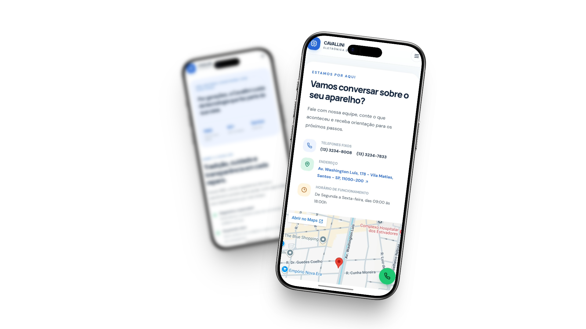

# 📺 Eletrônica Cavallini — Reestruturação Web

<p align="center">
  
  
  
  
</p>

<p align="center">
  
</p>

<p align="center">
  
</p>

---

## 📌 Sobre o projeto

Este projeto reestrutura a presença digital da **Eletrônica Cavallini**, assistência técnica autorizada localizada em Santos, São Paulo, com mais de 60 anos de atuação.

O objetivo é modernizar o site e torná-lo um canal claro e confiável para apresentar a empresa, seus serviços, as marcas atendidas e as formas de contato. A interface prioriza **seriedade, confiança, responsividade e uma navegação objetiva**, com conteúdo organizado e sem repetições desnecessárias.

> **Contexto acadêmico:** projeto de extensão do Curso Superior de Tecnologia em Sistemas para Internet da **FATEC Baixada Santista — Rubens Lara**.

## 🚀 Funcionalidades e melhorias

- **Design responsivo:** layout adaptado para computadores, tablets e smartphones, com abordagem mobile-first.
- **Navegação em página única:** acesso por âncoras às seções de marcas, serviços, sobre e contato.
- **Serviços:** apresentação de assistência para televisores, micro-ondas, caixas de som e eletroportáteis.
- **Marcas:** identificação das marcas autorizadas — Philco, Britânia, Toshiba, Aiwa e Mondial — e das marcas com atendimento especializado.
- **Contato direto:** links para WhatsApp e telefone, além de botão flutuante de WhatsApp.
- **Localização:** endereço da loja e mapa incorporado.
- **UX e acessibilidade:** conteúdo conciso, navegação semântica, rótulos acessíveis, texto alternativo nas imagens e respeito à preferência por movimento reduzido.
- **SEO básico:** título e descrição da página configurados no documento HTML.

O contato é feito por WhatsApp ou ligação telefônica. **Esta versão não inclui formulário de contato, API ou back-end.**

## 🛠️ Tecnologias utilizadas

- **React 19** — construção da interface e dos componentes.
- **Vite 6** — servidor de desenvolvimento e build de produção.
- **Tailwind CSS 3** — estilos utilitários e responsividade.
- **Lucide React** — ícones da interface.
- **Google Fonts** — famílias tipográficas DM Sans e Manrope.
- **GitHub Actions** — automação da publicação no GitHub Pages.
- **Node.js 20+ e npm** — ambiente e gerenciamento de dependências.

## 💻 Executar localmente

Requer Node.js 20 ou superior.

```bash
npm ci
npm run dev
```

O Vite exibirá no terminal o endereço local para abrir no navegador.

## 📦 Build de produção

```bash
npm run build
npm run preview
```

Os arquivos de produção são gerados na pasta `dist/`.

## 🌐 GitHub Pages

O workflow [`.github/workflows/deploy-pages.yml`](.github/workflows/deploy-pages.yml) compila o projeto e publica a pasta `dist/` após atualizações na branch `main`. Também pode ser iniciado manualmente pela aba **Actions** do GitHub.

O Vite está configurado para o caminho base do repositório `eletronica-cavallini`. A origem de publicação do GitHub Pages deve estar definida como **GitHub Actions** em **Settings → Pages → Build and deployment → Source**.

## 👥 Equipe desenvolvedora

Projeto desenvolvido colaborativamente por:

- **Kauê Santos da Silva**
- **Gabriel Nunes da Costa Anselmo**
- **Yasmim de Castro Ribeiro**

A equipe participou do levantamento de requisitos, planejamento de UX/UI, desenvolvimento front-end, organização do conteúdo e validação do site.
